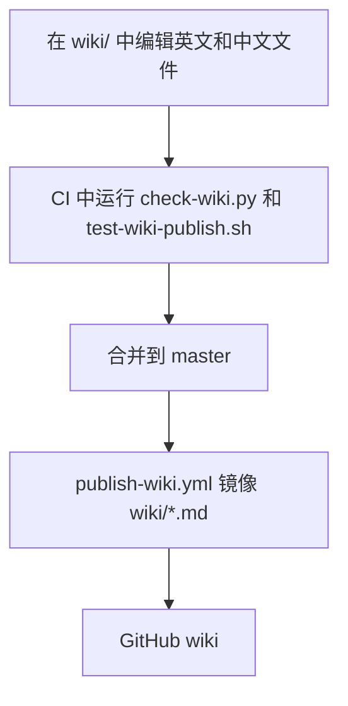

# Wiki 发布

[English](Wiki-Publication)

仓库根目录下受版本控制的 `wiki/` 目录是唯一的文档来源. 没有 `docs/` 目录.
每个主题都有一个英文 `<Page>.md` 和一个中文 `<Page>-zh-CN.md`, 两者标题层级顺序一致,
内容事实等同. 标题和正文使用文件对应的语言; 完整的两种语言译文不放在同一个文件中.
在同一次改动中同时更新两个文件.

Agent 在日常上下文中只加载英文文件. 只有在编辑或核对译文时才读取中文文件.
`CLAUDE.md` 只指向英文页面.

## 编写页面

- 用不带后缀的页面名链接其它页面, 例如 `[安全模型](Security-Model-zh-CN)`,
  不要写成 `Security-Model-zh-CN.md`.
- 保持在当前语言内: 英文页面链接英文页面, 中文页面链接 `-zh-CN` 页面.
  唯一的例外是每个标题下方的语言切换链接.
- 用 GitHub 绝对 URL 链接仓库中的文件; 相对路径在 wiki 上无法解析.
- `Home` 列出所有英文页面; `Home-zh-CN` 列出所有中文页面.
- 页面是扁平的: 没有子目录, 文件名只用 ASCII.

## 检查

```sh
python3 scripts/check-wiki.py
bash scripts/test-wiki-publish.sh
```

检查器要求每对页面的两个文件都存在, 拒绝混合两种语言的标题, 比较标题层级,
检查每个跨页面链接的目标和语言, 并检查两个 Home 页面都列出了所有页面.
它只校验页面目标, 不校验标题锚点; 锚点链接需要在渲染后的页面中检查.
这两个命令都在 `Tests` workflow 中运行.

## 发布

`.github/workflows/publish-wiki.yml` 在每次推送到 `master` 后运行
(包括每个合并的 pull request), 也可通过 `workflow_dispatch` 触发. 它先校验页面,
再用短期有效, 仅限本仓库的 `GITHUB_TOKEN` 克隆
`D0n9X1n/hexo-blog-encrypt.wiki.git`, 然后运行 `scripts/publish-wiki.sh`.
该脚本用 `wiki/*.md` 替换 wiki 中的 Markdown 页面, 仅在内容有变化时提交
`Publish wiki from <sha>`. 重命名和删除也会同步.

不要直接编辑 GitHub wiki: wiki 是单向镜像, 在浏览器中做的修改会在下次发布时被覆盖.


