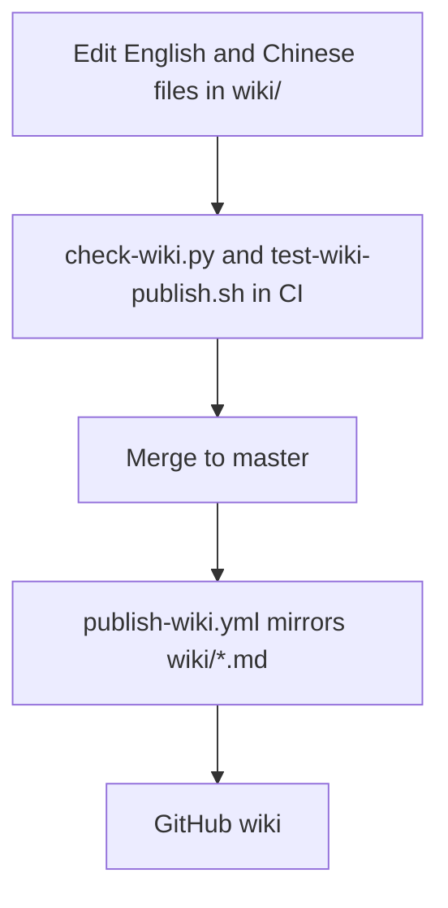

# Wiki Publication

[简体中文](Wiki-Publication-zh-CN)

The tracked `wiki/` directory at the repository root is the only documentation
source of truth. There is no `docs/` folder. Each topic has an English
`<Page>.md` and a Chinese `<Page>-zh-CN.md` with matching heading-depth order and
equivalent facts. Titles and prose stay in the file's language; full
translations never share a file. Update both files in the same change.

Agents load only the English files for routine context. Chinese files are read
when editing or verifying translations. `CLAUDE.md` points to English pages
only.

## Writing pages

- Link other pages by bare page name, for example `[Security Model](Security-Model)`,
  never `Security-Model.md`.
- Stay in the current language: English pages link English pages, Chinese pages
  link `-zh-CN` pages. The only exception is the language-switch link under each
  title.
- Link repository files with absolute GitHub URLs; relative paths do not resolve
  on the wiki.
- `Home` lists every English page; `Home-zh-CN` lists every Chinese page.
- Pages are flat: no subfolders, ASCII file names.

## Checking

```sh
python3 scripts/check-wiki.py
bash scripts/test-wiki-publish.sh
```

The checker requires both members of every pair, rejects combined-language
headings, compares heading depths, checks every cross-page link target and
language, and checks that both Home pages list every page. It validates page
destinations, not heading anchors; check anchor links in the rendered pages.
Both commands run in the `Tests` workflow.

## Publishing

`.github/workflows/publish-wiki.yml` runs after every push to `master`, including
every merged pull request, and on `workflow_dispatch`. It validates the pages,
clones `D0n9X1n/hexo-blog-encrypt.wiki.git` with the short-lived, repository-scoped
`GITHUB_TOKEN`, and runs `scripts/publish-wiki.sh`. The script replaces the
wiki's Markdown pages with `wiki/*.md` and commits `Publish wiki from <sha>`
only when content changed. Renames and deletions propagate.

Never edit the GitHub wiki directly: the wiki is a one-way mirror, and browser
edits are overwritten on the next publish.


